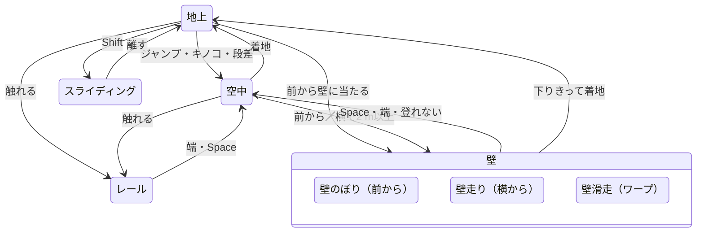

# ブリンク・エクスプレス 仕様書

最終更新：2026-11-17

## 概要

この仕様書は、Webデモ版（v14）で確定した操作・ルール・数値を、Unityで実装するための基準としてまとめたもの。数値はすべてデモ版の値で、調整の出発点とする。

- **単位：** 距離は m、速さは m/s、時間は秒。画面の速度表示は「m/s × 2.4 = km/h」で換算する（例：30 m/s → 72 km/h）
- **座標：** コースは +Z 方向に進む。コース幅は X = −22〜+22 m、両脇は高さ14 mの壁
- **時間：** 照準中は世界全体が0.25倍速になる。以下の「秒」は、特記がなければゲーム内時間（スローの影響を受ける）
- **重力のルール：** 重力は進む向きを曲げるだけで、速さは変えない（落ちても加速しない）
- **デモ版：** https://claude.ai/artifact/Ckr9sCb7JmMrH2Hag85ifP
- **企画書：** 「ブリンク・エクスプレス_企画書.md」

## 操作

キャラは常に前へ滑り、マウスで向けた方向へ自動で曲がる。「見た方向へ走り、見た方向へ投げる」が基本。

| 操作 | キーボード＋マウス | コントローラー（予定） | 内容 |
| --- | --- | --- | --- |
| カメラ・進む向き | マウス | 右スティック | キャラはカメラの向きへ毎秒5 radまで曲がる。照準中は向きを固定 |
| 左右に寄せる | A / D | 左スティック左右 | カメラの向きから±0.6 rad（約34°）ずらす |
| ブレーキ | S | 左スティック下 | 毎秒28 m/s減速（最低8 m/s） |
| 照準 | 左クリック長押し | LT長押し | スロー＋ゲージ消費 |
| 投げる | 左クリックを離す | LTを離す | ビーコンを発射 |
| 照準キャンセル | 右クリック | RT | 投げずに通常速度へ |
| ジャンプ・壁ジャンプ | Space | A | 地上：ジャンプ、壁：壁ジャンプ、レール：降りる、空中：二段ジャンプ |
| スライディング | Shift（またはC）長押し | B | 地上で低くなる |
| リスタート | R | Start | 最初から |
| 音のオン・オフ | M | — | — |

コントローラーの割り当てはデモ版に未実装の仮案。

## プレイヤーの状態

プレイヤーは地上・スライディング・空中・壁・レールの5つの状態を持ち、ステートマシンで管理する。壁の状態は当たり方で、壁のぼり・壁走り・壁滑走の3つに分かれる。

ワープは着弾先に応じて、地上・壁滑走・レール・空中のどれかへ直接移る。

## 速度

速さは 8〜60 m/s（19〜144 km/h）。スケートだけで出せるのは30 m/s（72 km/h）までで、それより上はワープ・コイン・破壊・レールでしか上がらない。上がった速さは、減速要因がない限り保たれる。

| 区分 | 要因 | 変化 |
| --- | --- | --- |
| 加速 | スケート（通常時） | 毎秒+3 m/s、30 m/sまで。スライディング中は加速しない |
| 加速 | ワープ | 単発+3 m/s。チェインでさらに+3 m/sずつ（ワープの節） |
| 加速 | コイン | 1枚+1.2 m/s |
| 加速 | 敵の破壊 | やわらかい+3、ふつう+4、かたい+6 m/s |
| 加速 | レール上 | 毎秒+4 m/s |
| 減速 | ブレーキ（S） | 毎秒−28 m/s |
| 減速 | 泥の床（地上にいる間） | 毎秒−16 m/s（スケートの加速も打ち消す） |
| 減速 | 速度不足で敵に弾かれる | ×0.5 |
| 減速 | 天井に当たる | ×0.55 |
| 減速 | 登れない障害物（紫の壁・倒木）に正面で当たる | ×(1 − 0.45 × 当たりの深さ)。深さは進行方向と壁の法線の内積で、0.35未満なら減速なし |

開始時の速さは14 m/s。高い所から落ちても減速しない（落下のルールは廃止）。

## ワープ

ビーコンが何かに当たった瞬間に自動でワープし、速さを保ったまま投げた方向へ向きを変える。そのうえで「ワープ → 少し滑る → 次を投げる」のリズムを守ると加速する。

### 照準とゲージ

- 照準を始めるたびにゲージ0.08を消費し、照準中は実時間で毎秒0.15ずつ減る（満タンで約6秒狙える）
- ゲージが空になると照準は解除される。空のときは照準もワープもできない
- 回復：時間で毎秒+0.05（実時間）、コイン1枚+0.05、敵の破壊+0.15〜0.3。開始時は0.7
- 照準中は世界が0.25倍速になる（完全には止まらない）
- 投げた後は0.35秒のクールタイム。ビーコンは同時に1つだけ

### ビーコンの弾道

- 初速：70 + 自分の速さ × 0.5 m/s、向きはカメラの正面（上下も含む）
- 重力：45 m/s²の放物線。水平に投げると約20 m先、少し上に向けると約70 m先に落ちる
- 寿命：2秒。何にも当たらなければ消えて不発（クールタイムのみ消費）
- 当たり判定は1/120秒刻みで線分として調べる（薄い壁をすり抜けないように）

### チェイン

| 前のワープから投げるまでの時間 | 判定 | ワープ時の加速 |
| --- | --- | --- |
| 0.3秒未満 | 早すぎ（連打） | なし。チェインは0に戻る |
| 0.3〜1.6秒 | チェイン継続 | +3 + 3 × (チェイン数 − 1) m/s |
| 1.6秒以上 | 単発 | +3 m/s、チェインは1から |

判定は投げた瞬間に確定し、着弾時に適用する。紫の壁に当たるとチェインは0に戻る。

### 着弾したものごとの結果

| 着弾したもの | 予測の色と表示 | ワープ後 |
| --- | --- | --- |
| 地面・箱の上面 | 水色「着地」 | 地上。向きは投げた方向の水平成分 |
| 登れる壁の側面 | 水色「壁滑走」 | 壁滑走。向きは投げた方向を壁面に投影したもの。真正面ならカメラの向きを投影 |
| 天井（箱の下面） | オレンジ「天井・減速」 | すぐ落下、速さ×0.55 |
| 速さが足りる敵 | 緑「粉砕できる」 | 粉砕（「敵・コイン・トラップ」参照） |
| 速さが足りない敵 | 黄「速度不足」 | 弾かれ、速さ×0.5。横へ逸れる |
| レール | 白「レール」 | レールに乗る。進む向きは投げた方向に近い側 |
| 紫の壁・倒木の側面 | 赤「ワープ不可」 | ワープしない |
| 何もない | 灰「届かない」 | ワープしない |

敵に対する「粉砕できるか」は、ワープの加速を足した後の速さで判定する。

## ジャンプと壁

ジャンプも壁の動きも、速さは変えずに進む向きだけを変える。壁は「当たる向き」で動きが分かれる。

### ジャンプ

- 地上でSpace：上向きの成分が 12.5 m/s になるよう向きを傾ける（上向きの割合は最大0.8）。高さは約3 m
- 空中の重力：26 m/s²で向きを下へ曲げる
- 空中の旋回：地上の0.35倍
- 二段ジャンプ：40 m/s（96 km/h）以上のとき、空中で1回だけ。着地、壁への張り付き、レール、キノコで復活

### 壁

登れる壁は、種類「壁」で高さが2.5 mより高く、頭が壁の上端より1 m以上下にあるもの。「当たりの深さ」は進行方向と壁の法線の内積。

| 当たり方 | 条件 | 動き |
| --- | --- | --- |
| 前から | 当たりの深さ > 0.7（約45°以内）、地上・空中どちらでも | 壁のぼり。真上へ、上昇速度は自分の速さから始まり毎秒20ずつ減る。登れる高さ = 速さ² ÷ 40（30 m/sなら22.5 m） |
| 横から（地上） | 当たりの深さ 0.7以下 | 壁に沿って向きが変わるだけ。減速しない |
| 横から（空中） | 壁から1.2 m以内、壁とほぼ平行、地面から2 m以上 | 壁走り。水平にまっすぐ1.2秒、その後は重力13 m/s²で下へ曲がる |
| 横から（空中、低い） | 地面から0.5 m以上2 m未満 | 壁滑走。壁から離れたら終わる。0.5 m未満は地面の判定と入れ替わってちらつくので滑らせない |
| ワープで壁に着弾 | — | 壁滑走。重力13 m/s²で弧を描いて下りる |

- **壁走りの接触：** 壁に沿って進むと接触の判定が途切れることがある。まっすぐ走る1.2秒の間は、途切れても続ける。そのあと0.2秒接触が無ければ終わる
- **登りきった：** 壁の上端に乗り上げ、壁の内側へ進む
- **登りきれなかった：** カメラの向きに近い壁沿いの方向を向いて下りる。その壁には1.2秒登れない（同じ壁に何度も張り付くのを防ぐ）
- **壁の端を過ぎた、上端を越えた：** 空中へ
- **壁ジャンプ（壁走り・壁滑走中のSpace）：** 「壁から離れる向き × 0.75 ＋ 上 × 0.6 ＋ 進んでいた水平方向 × 0.6」へ跳ぶ。二段ジャンプ復活。その壁には0.3秒張り付かない
- **壁のぼり中のSpace：** 後ろへは跳ばず、上昇速度に+16 m/s（1回だけ）
- **逆走しない：** 登れない障害物に真正面から当たったときは、跳ね返さずカメラが向いている側へ壁沿いに逃がす

## スライディング・レール・キノコ

操作として追加するのはスライディングだけで、レールとキノコは触れると自動で動くステージの仕掛け。

### スライディング

- 地上でShiftを押している間、速さが12 m/s以上ならスライディング
- 当たり判定の高さ：1.8 m → 0.9 m。倒木（下端1.1 m）の下をくぐれる
- 速さは保つが、スケートの加速は止まる。曲がる速さは0.4倍
- 倒木の下で離しても、立ち上がると頭がぶつかる間はスライディングを続ける
- ジャンプ、ワープ、壁のぼりで解除

### グラインドレール

- 直線の線分として置く。足元がレールから水平1.1 m以内、上下はレールの1 m下〜1.4 m上、進行方向とレールの角度が約70°以内なら自動で乗る（空中で上昇中は乗らない）
- 乗っている間は毎秒+4 m/s。進む向きは乗ったときの向きに近い側
- 端まで行くと、レールの向きより少し上向きで飛び出す
- Spaceで降りる（その場でジャンプ）。降りた後0.4秒は再び乗らない
- ビーコンで直接ワープして乗れる

### 跳ねるキノコ

- 半径2.2 m以内、足元が2.6 m以下で触れると発動（空中で上昇中は除く）
- 上向きの成分が min(速さ × 0.9, 24) m/s になるよう向きを傾ける。高さは約10 m
- 二段ジャンプ復活。発動後0.4秒は再発動しない

## 敵・コイン・トラップ

敵は硬さで3段階。攻撃はしない。当たったときの自分の速さが必要速度以上なら粉砕、足りなければ弾かれる。

| 硬さ | 当たり半径 | 必要速度 | 粉砕時の加速 | コイン | ゲージ回復 | 時間が止まる演出 |
| --- | --- | --- | --- | --- | --- | --- |
| やわらかい | 1.1 m | 0 | +3 m/s | 1 | +0.15 | 0.07秒 |
| ふつう | 1.7 m | 26 m/s（62 km/h） | +4 m/s | 2 | +0.2 | 0.09秒 |
| かたい | 2.8 m | 48 m/s（115 km/h） | +6 m/s | 4 | +0.3 | 0.11秒 |

- 接触判定：体の中心（足元1 m上、スライディング中は0.5 m上）と敵の中心の距離が「敵の半径 + 0.9 m」未満。当たった後0.35秒は無敵
- 行動は配置ごとに設定：「動かない」「左右に動く（±5 m）」「逃げる（前方35 m以内に来たら横へ毎秒7 m）」
- 粉砕で出たコインは画面上でコイン表示へ飛んでいく

### コイン

- 取得判定：体の中心から1.9 m以内
- 1枚で +1.2 m/s、ゲージ +0.05
- 理想の走行ライン、壁や塔の上、レールの先など、「うまく走ったら取れる場所」に並べる

### トラップと障害物

| 種類 | 効果 | デモ版の状況 |
| --- | --- | --- |
| 減速床（泥） | 地上にいる間、毎秒−16 m/s | 実装済み |
| ワープ妨害面（紫の壁） | ビーコンが当たってもワープ不発。登れない | 実装済み |
| 倒木 | 高さ1.1〜2.3 mの横棒。スライディングかジャンプで越える。側面はワープ不可 | 実装済み |
| 接触トラップ | 地面の上の仕掛け（平原では粘着する草）。触れると速さ×0.5（下限8 m/s）。触れるたびに1回だけ当たり、いったん離れると再び当たる。ジャンプで跳び越せる | Unity版で実装（デモ版は未実装。数値は暫定） |
| タイミングトラップ | 一定間隔で出現し、当たると大きく減速 | 未実装 |
| 低い天井 | 下から当たると落下して×0.55 | 実装済み |

## 追ってくるもの・ゴール・評価・ゴースト

追ってくるものは一定速度20 m/sで、スケートだけの上限30 m/sより遅い。減速が重なると追いつかれ、ワープを使うほど余裕が生まれる。（試作で26 m/sから下げた。シーンの設定値が正）

- **追ってくるもの：** 開始時はプレイヤーの50 m後ろ、1.5秒後に動き出す。プレイヤーの1.5 m後ろまで追いついたら失敗。ステージごとに見た目だけ変える（魔物の群れ、雪崩、溶岩流）
- **ゴール：** 平原は Z = 1500 m。到達でクリア
- **評価：** クリアタイムとコインの取得率で決める

| ランク | 条件（平原） |
| --- | --- |
| S | 48秒未満、かつコイン60%以上 |
| A | 58秒未満、かつコイン35%以上 |
| B | 75秒未満 |
| C | それ以外 |

- **ゴースト：** プレイ中はゲーム内時間0.05秒ごとに位置と向きを記録。自己ベストを更新したら保存し、次回から半透明のキャラとして同じ時刻の位置に再生する（前後の記録を線形補間）。右上にベストタイムを表示

## カメラとUI・演出・サウンド

### カメラ

- **通常：** プレイヤーの右肩1.5 m、高さ2.2 mを注視点にし、後ろ 8.5 − 2 × (速さ ÷ 60) m。マウスで向きを変え、自動で背後には戻らない。上下の角度は −0.6〜0.55 rad
- **視野角：** 60° + 36° × (速さ ÷ 60)。ワープ直後は最大+14°広がり、元に戻る
- **照準中：** 0.12秒かけて「右肩1.1 mの後ろ3.4 m、少し上」の肩越し視点へ移る。体は不透明度0.25まで薄くなり、視野角は10°狭くなる。マウス感度は通常の約0.6倍
- **壁走り中：** 壁と反対側へ最大0.22 rad傾ける
- **揺れ：** 破壊、弾かれたとき、障害物への衝突、高い所からの着地で短く揺らす。動きを減らす設定のときは揺れ、傾き、集中線を無効

### UI

| 位置 | 要素 | 内容 |
| --- | --- | --- |
| 中央 | ゲージの円弧・クールタイム・十字 | 十字はチェイン受付中に水色、早すぎる間は薄くなる。照準中はすべて消す |
| 中央の下 | チェイン数 | 「CHAIN ×n」「早すぎ：加速なし」 |
| 照準中 | 予測線と着弾点 | 縁取り付きの光の点を1.8 mおきに並べる（画面上で一定の大きさ）。着弾点に距離で大きさが変わる輪と光の柱。色は「ワープ」の着弾表どおり |
| 照準中・上部 | スロー表示とゲージバー | 残り1/4未満でオレンジ |
| 左下 | 速度メーター | km/hの数値とバー。中・高の硬さとスケート上限に目盛り。上限95%以上で光る。「二段ジャンプ可」表示。減速時はオレンジに点滅 |
| 右上 | タイム・ベスト・コイン | — |
| 上部 | 進行バー | 追ってくるもの・自分・ゴールの位置 |
| 上部 | 案内 | 初めての仕掛けの手前で3.2秒表示。照準中は隠す |

照準中は速度・タイムのパネルを不透明度0.4にし、画面全体に薄い青を重ねる。

### 演出

- ワープ：白いフラッシュ、出発地点から到着地点まで光の残像
- 粉砕：破片、衝撃波の輪、時間が止まる演出（0.07〜0.11秒）
- 速度：上限45%以上で集中線。照準中は出さない
- 追ってくるものとの差が45 mを切ると、画面の縁が赤くにじむ
- スライディング・レール・壁走り中は足元に火花や砂ぼこり

### サウンド

デモ版は音声ファイルを使わずに合成している。Unity版では同じ場面に素材を当てる。

- 単発：ワープ、粉砕、コイン、ジャンプ、二段ジャンプ、着地（1.5 m以上の落下）、弾かれる・衝突、キノコ、壁に張り付く、スライディング開始、レールに乗る
- 継続：風切り音（速さで音量と高さが上がる）、レール・壁走り・スライディングの摩擦音
- Mキーで音のオン・オフ

## ステージ1（平原）の区間構成

全長1500 m、10区間。各区間に「安全だけど遅い道」と「技を使う近道」を用意し、ワープなしでもクリアできるようにする。目安のクリアタイムは45〜75秒。

| # | 区間 | Z（m） | 主な仕掛け | 教えること |
| --- | --- | --- | --- | --- |
| 1 | 入口 | 0–180 | 最初の壁（高さ14 m、上にコイン）、キノコ、左の上りレール、やわらかい敵 | 照準とワープ、チェイン、壁のぼりと壁走り、キノコ、レール |
| 2 | 泥の原 | 180–300 | 左半分の泥、泥の上のレール、右側のコインライン、ふつうの敵 | ジャンプで跳び越える、脇を回る |
| 3 | 紫の壁 | 300–420 | 倒木、中央だけ開いた紫の壁、屋根への上りレール | スライディング、ワープできない壁 |
| 4 | 低い屋根 | 420–540 | 高さ6 mの屋根（上にコイン）、泥、かたい岩 | 天井での減速、かたい敵は高速でしか壊せない |
| 5 | 柱の林 | 540–670 | 高さ18 mの柱が交互に6本、上空11 mのレール | 壁ジャンプでジグザグ |
| 6 | 段々畑 | 670–800 | 左は高さ3/6/9/12 mの4段、右は泥の道とキノコ | 段を登る道と遅い道の選択 |
| 7 | 三本道 | 800–980 | 倒木、仕切り壁で分かれた道（真ん中は泥とレール、両脇は高さ6 mの横壁） | 壁走り、横壁の乗り越え |
| 8 | 塔と大壁 | 980–1100 | 高さ30 mの塔（正面と頂上にコイン）、塔の頂上からの下りレール、コース幅いっぱいの高さ9 mの壁、キノコ | 高速の壁のぼり、壁を越える手段の選択 |
| 9 | 泥の沼 | 1100–1270 | 全幅の泥、7本の柱（高さ4〜6 m）、右側のレール、キノコ | 柱から柱へのジャンプ |
| 10 | 最後の関門 | 1270–1500 | 倒木、隙間の位置がずれた紫の壁2枚、かたい岩3体、泥、キノコ、レール | それまでのすべて |

コインは約140枚、敵は39体（やわらかい19、ふつう14、かたい6）、レール8本、キノコ6個、倒木3本。配置座標はデモ版のソースを正とする。

## 調整パラメータ一覧

Unity版ではこれらをScriptableObjectに切り出し、インスペクターで調整できるようにする。変数名はデモ版のソースと同じ。

| 分類 | 変数名 | 値 | 意味 |
| --- | --- | --- | --- |
| 速度 | minSpd / maxSpd | 8 / 60 m/s | 速さの下限と上限 |
| 速度 | cruise | 30 m/s | スケートだけで出せる上限 |
| 速度 | startSpd | 14 m/s | 開始時の速さ |
| 速度 | accel | 3 m/s² | スケートの加速 |
| 速度 | brake | 28 m/s² | ブレーキ |
| 速度 | mud | 16 m/s² | 泥の減速 |
| 操作 | steer | 5 rad/s | カメラの向きへ曲がる速さ |
| 操作 | lean | 0.6 rad | A/Dで寄せる角度 |
| 物理 | g | 26 m/s² | 空中の重力（向きを曲げる） |
| 物理 | wallG | 13 m/s² | 壁滑走・壁走り後半の重力 |
| 物理 | climbG | 20 m/s² | 壁のぼりの減速 |
| ジャンプ | jumpV | 12.5 m/s | ジャンプの上向き成分 |
| ジャンプ | dblSpd | 40 m/s | 二段ジャンプできる速さ |
| 壁 | frontDot | 0.7 | 前からと横からの境目 |
| 壁 | runH | 2 m | 壁走りを始める高さ |
| 壁 | runTime | 1.2 秒 | 壁走りでまっすぐ走る時間 |
| ワープ | beaconBase | 70 m/s | ビーコンの初速（＋速さ×0.5） |
| ワープ | beaconG | 45 m/s² | ビーコンの重力 |
| ワープ | beaconLife | 2 秒 | ビーコンの寿命 |
| ワープ | cool | 0.35 秒 | 投げのクールタイム |
| ワープ | slow | 0.25 | 照準中の時間の速さ |
| ワープ | drain / aimCost / regen | 0.15 / 0.08 / 0.05 | ゲージの消費（毎秒）・照準開始時の消費・時間回復（毎秒） |
| ワープ | warpBoost / chainBoost | 3 / 3 m/s | ワープの加速とチェインごとの上乗せ |
| ワープ | chainMin / chainWin | 0.3 / 1.6 秒 | 連打とみなす時間・チェインの受付時間 |
| 仕掛け | railAccel | 4 m/s² | レール上の加速 |
| 仕掛け | bounceV | 24 m/s | キノコの上向き成分の上限 |
| 仕掛け | slideMin | 12 m/s | スライディングできる速さ |
| 進行 | chaser / chaserDelay | 20 m/s / 1.5 秒 | 追ってくるものの速さと動き出すまで |
| 進行 | goalZ | 1500 m | ゴールの位置（平原） |
| 表示 | kmh | 2.4 | m/sから表示用km/hへの倍率 |
